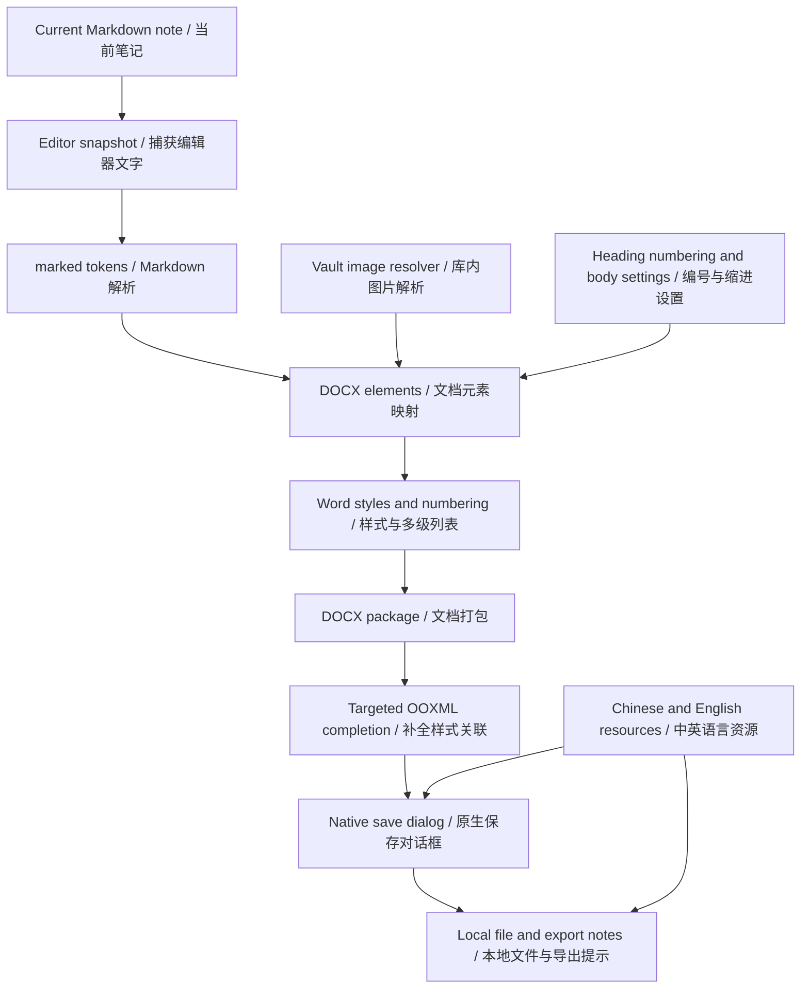

# NotePort architecture / 笔呈架构

[English README](../README.md) · [中文介绍](../README.zh-CN.md)

## Purpose / 目标

Convert one active Markdown note into an editable DOCX with semantic Word styles. NotePort does not render a screenshot into a document or use Word/Pandoc as a conversion service.

将当前 Markdown 笔记转换为具有 Word 样式语义的可编辑文档。插件不把截图塞进 Word，也不依赖 Word 或 Pandoc 执行转换。

## Modules / 模块

| File | Responsibility / 职责 |
| --- | --- |
| `src/main.ts` | Obsidian lifecycle, command/ribbon/menu, editor capture, modal UI, image resolver, native save dialog and completion UI / 插件入口、编辑器快照、交互、图片解析和保存 |
| `src/exporter.ts` | Markdown → Word elements, styles, numbering, DOCX packaging, structured warnings / 解析、元素映射、样式编号、打包和提示 |
| `src/settings.ts` | Defaults and defensive settings loading / 默认配置和配置校验 |
| `src/i18n.ts` | Language resolution and complete Chinese/English UI dictionaries / 语言选择和双语资源 |
| `styles.css` | Scoped Obsidian UI styles / 仅作用于插件界面的样式 |
| `tests/exporter.test.ts` | DOCX structural/behavior regression tests / 导出结构和行为回归测试 |
| `scripts/export-example.ts` | Reproducible public fixture exports / 可复现公开示例 |
| `scripts/package.mjs` | Installable release ZIP and SHA-256 manifest / 安装包和校验清单 |

## Content pipeline / 内容转换

1. Capture the active note and editor text before opening a modal. Reading mode falls back to the vault file. / 打开弹窗前捕获当前笔记和编辑器内容，必要时读取库内文件。
2. Remove a leading YAML frontmatter block. Do not alter the source file. / 排除文件头部属性区，不写回原文。
3. Parse GFM Markdown with `marked`. A custom inline extension recognizes wiki links and embeds; code spans and fenced code retain literal text. / 解析 Markdown；专门识别双链和嵌入语法，避免处理代码内的同名语法。
4. Map tokens recursively to `Paragraph`, `TextRun`, `Table`, `ExternalHyperlink`, and `ImageRun`. / 递归映射为可编辑文档元素。
5. Resolve local images through Obsidian's metadata cache using the source note path. Read supported image bytes and cap the dimensions to the A4 content area. / 依据来源笔记路径解析本地图片并等比限制尺寸。
6. Build styles and list definitions, package the DOCX, complete two missing OOXML features, then prompt for a destination. / 生成样式、列表并打包，补全必要 XML 属性后选择保存位置。
7. Write the document and show export notes. A cancelled save produces no output file and does not remember new options. / 保存后显示结果；取消保存不写文件、不记住本次选项。

## Heading semantics / 标题语义

Each H1–H6 paragraph has its native `Heading1`–`Heading6` style and corresponding outline level. A single heading-numbering definition supplies `%1`, `%1.%2`, and so on. Numbered exports set both paragraph numbering and style numbering; each numbering level also references its heading style. Child levels use Word's default restart-after-parent behavior.

一级至六级标题使用 Word 原生样式与大纲级别。所有标题共用一个多级编号定义，同时建立段落、标题样式、编号级别之间的关联；使用 Word 默认的父级变化后子级重启规则。不是在标题字符串前拼接编号。

The pinned `docx` version lacks a public option for the numbering level's `w:pStyle` and character-unit indentation. NotePort uses JSZip to complete those attributes in its own generated XML. It also removes `ListParagraph` references injected inside heading style definitions by the library. Explicit paragraph numbering is required because desktop Word did not consistently display child-level numbering inherited only through styles during validation.

当前固定版本的 `docx` 未公开编号级别关联样式和字符单位缩进的完整选项，插件仅对自身生成的 XML 做定向补全，并移除库在标题样式内部附加的列表样式引用。实测发现仅依赖样式继承不能稳定显示下级编号，因此也显式设置标题段落的编号属性。

Plain exports define no heading numbering association. Original title text, including manually typed prefixes, is retained. Skipped levels are preserved rather than renumbered into a different hierarchy.

关闭自动编号时不关联标题编号。保留原标题文字，包括手写前缀；不擅自修正跳级标题。

## Body styles / 正文样式

`Normal` owns body typography, 1.5 line spacing, paragraph spacing, and `w:firstLineChars="200"` when two-character indentation is selected. Other paragraph styles reset first-line indentation. Fonts are referenced, not embedded. The output uses fixed plugin defaults and never reads personal Word templates.

Normal 样式负责正文排版；两字符缩进使用 `w:firstLineChars="200"` 表示。其他样式显式重置首行缩进。文档引用字体但不嵌入字体，不读取个人 Word 模板。

## Data and failure boundaries / 数据与异常边界

- No conversion network calls, telemetry, or remote image fetching. / 无转换网络调用、遥测及网络图片下载。
- Only the current note and resolved vault image files are read. / 仅读取当前笔记及解析出的库内图片。
- The selected destination receives the DOCX; Obsidian's plugin `data.json` stores only language and two export options. / 输出只写到选择位置，配置仅保存语言、编号和缩进。
- Native save UI handles normal overwrite confirmation. Export errors remain visible in an Obsidian notice; missing or unsupported content produces completion notes. / 原生保存界面处理通常的覆盖确认，错误通过提示显示，不支持内容在完成界面列明。
- Source note content is not rewritten. HTML is not executed; non-HTTP(S)/mailto links do not become active DOCX links. / 不改写来源笔记，不执行 HTML，非网页和邮件链接不生成活动链接。
- The export holds the parsed document and image data in memory. Large notes/images can require significant memory; there is no streaming or background queue in this release. / 首版在内存中处理，大型笔记或图片会增加内存占用，没有流式处理和后台队列。

## Extension points / 后续扩展

Custom templates would enter at the style mapping stage. Additional Markdown constructs would extend token conversion. Multiple-note export would need explicit ordering and link-resolution rules before sharing the current pipeline. These are design directions, not shipped features.

后续模板可接入样式映射层，新语法可扩展元素转换层；多篇合并需要先定义顺序和链接解析规则。上述均为扩展方向，不代表首版已实现。
