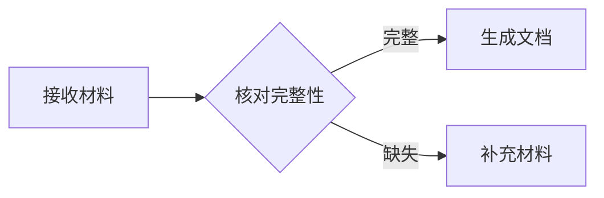

# Pictures and Mermaid / 图片与 Mermaid

Version / 版本: **0.2.0**

## Local pictures / 本地图片

Both Markdown and Obsidian attachment syntax are supported. Paths are resolved relative to the current note through Obsidian, including Chinese filenames and percent-encoded spaces.

支持 Markdown 图片和 Obsidian 附件嵌入，依据当前笔记位置解析路径，兼容中文文件名及编码空格。

```md


![[picture.png]]
![[picture.png|400]]
![[picture.png|400x300]]
```

PNG, JPEG, GIF, and BMP are embedded directly. SVG and WebP become PNG locally. A width/height hint defines a maximum box; images retain their aspect ratio and are constrained to the page, list, or table-cell width. Image-only paragraphs have no body first-line indent.

PNG、JPEG、GIF、BMP 直接嵌入，SVG、WebP 本地转为 PNG。尺寸参数定义最大边界，图片保持比例，并限制在页面、列表或表格单元格可用宽度内。纯图片段落不使用正文首行缩进。

Remote URLs are not fetched. Missing/unsupported images keep a visible placeholder and an export note. GIF animation is not guaranteed in Word. SVGs with external assets or HTML inside `foreignObject` may not rasterize faithfully as standalone image files.

不下载网络图片。缺失或不支持的图片保留文字占位并提示；不保证 Word 中的 GIF 动画。SVG 中引用外部资源或以 `foreignObject` 包含 HTML 时，可能不能完整还原。

## Mermaid diagrams / Mermaid 图表

Use a fenced block with the `mermaid` language. No additional toggle is required.

使用语言标记为 `mermaid` 的代码块，无需开启新设置。

````md

````

Each block becomes a static PNG picture in its original position. The document keeps surrounding text editable. Rendering uses bundled Mermaid 12.3.0 in a separate local sandbox, with a light default theme and no internet connection. Obsidian's preview/theme configuration is not changed. Custom diagram themes may override the light default, subject to the renderer's security settings.

每个代码块在原位置转为静态 PNG，前后正文仍可编辑。插件内置 Mermaid 12.3.0，在独立本地沙箱中渲染，默认浅色主题，不联网，不修改 Obsidian 预览配置。图表自身的主题配置可在安全设置允许的范围内覆盖默认主题。

The image is rasterized at twice its logical Word size for clear labels. Very large/dense diagrams are scaled down to fit the page and can be harder to read. Links, hover effects, and callbacks are not exported as interactive behavior. External icons, fonts, and images are blocked; an independently installed Mermaid extension or newer syntax may differ from Obsidian's preview.

图像按 Word 逻辑尺寸两倍生成，提升标签清晰度。大型密集图表会缩小，可能影响可读性；链接、悬停、回调不保留为交互。外部图标、字体和图片禁止加载；扩展语法或版本差异可能造成与 Obsidian 预览不一致。

## Failure handling / 转换失败

Invalid Mermaid, unavailable rendering, or a 20-second conversion timeout keeps the source as a code block and reports the failed diagram. Later diagrams and ordinary text continue exporting. Diagram source is limited to 50,000 characters and 1,000 edges; SVG/WebP conversion is limited to 20 MB per file.

Mermaid 语法错误、渲染不可用或单图转换超过 20 秒时，保留源码并列出失败提示；后续图表和正文继续处理。单图源码上限为 50,000 字符、1,000 条边，SVG/WebP 转换上限为每个文件 20 MB。

Try the [mixed Markdown fixture](../examples/图文与Mermaid示例.md) and [its DOCX result](../examples/sample-media.docx).

可以下载[混合示例笔记](../examples/图文与Mermaid示例.md)及[对应 Word](../examples/sample-media.docx)检查效果。
