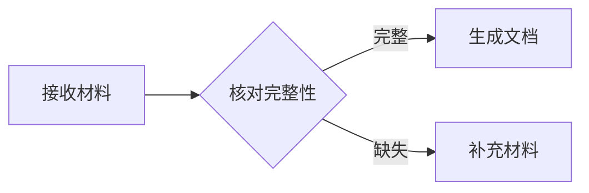
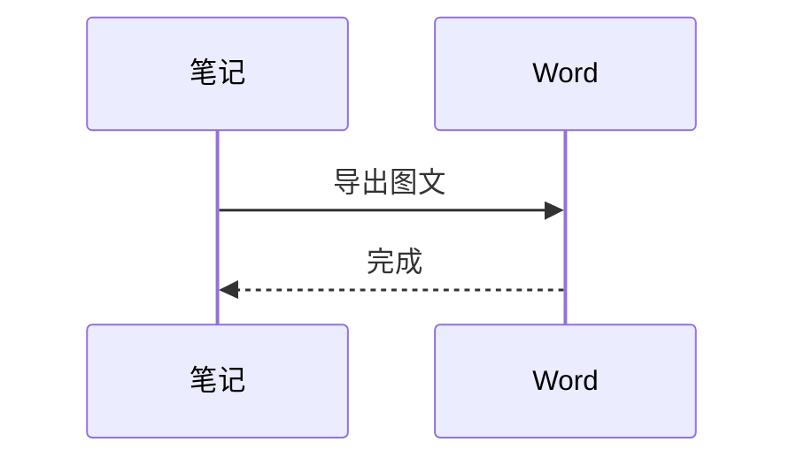

# 图文与 Mermaid 导出验证

本示例用于检查图片与图表在 Word 中的位置、中文标签和可读性，全部内容均为虚构演示资料。

## 本地图片

以下图片通过标准 Markdown 图片语法插入，指定宽度为 400 像素。

同一张图片也可以通过 Obsidian 嵌入语法引用。

![[assets/reading-plan.png|300]]

## SVG 和 WebP

## Mermaid 流程图

图表后面的正文应继续保留，图表在 Word 中以图片形式存在。

## Mermaid 时序图

导出结束后，可以在 Word 中继续编辑正文及标题，图表保持为静态图片。
