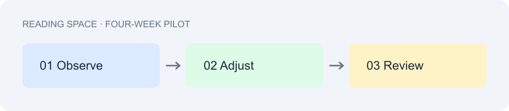

# 城市阅读空间改进计划

本文整理社区阅读空间的改进目标与执行安排，供项目组讨论。我们建议先完成座位与导引优化，再根据四周观察结果决定是否增加活动场次。

## 项目目标

本次改进面向日常阅读、自习与小型交流三个场景，优先解决入口指引不清、安静区域边界模糊等问题。所有数据均为演示数据。

### 预期成果

- 提供更清楚的区域导引。
- 保留适合个人阅读的安静座位。
- 建立每周一次的反馈整理机制。

**关键原则**：先观察，再调整。活动安排保持*小规模、可复盘*，~~立即全面扩建~~暂不纳入本期。

## 执行安排

| 阶段 | 主要工作 | 交付物 |
| --- | --- | --- |
| 第一周 | 现场观察与意见收集 | 需求清单 |
| 第二周 | 导引与座位布局调整 | 试行方案 |
| 第三至四周 | 观察使用情况并复盘 | 改进记录 |

### 现场工作顺序

1. 检查入口与公共区域。
2. 整理意见并记录问题。
   - 区分设施问题与使用习惯问题。
   - 为每项调整指定负责人。
3. 确认试行安排并发布通知。

> 建议每周固定一次短会，只讨论新发现的问题及对应措施。

## 评估与交流



评估记录应包含时间、位置、问题描述与处理结果。项目成员可以参考 [[项目记录|项目记录笔记]] 补充背景信息，并通过 [Obsidian 官网](https://obsidian.md) 了解笔记工具。

### English summary

Start with small, measurable improvements. Review observations after four weeks and decide the next step together.

```text
Observe → Adjust → Review
```
